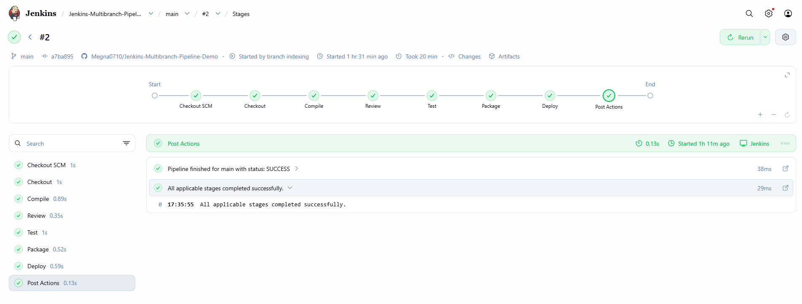
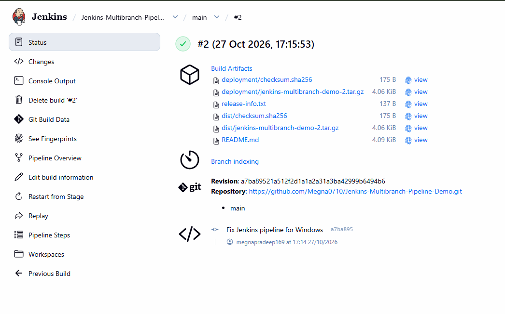
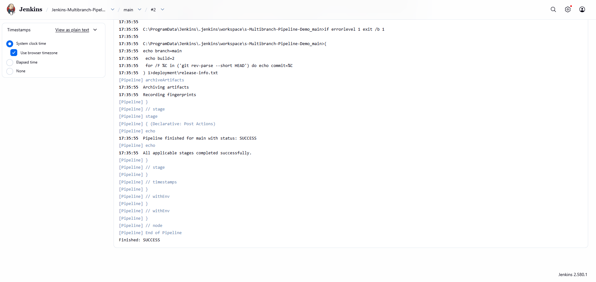
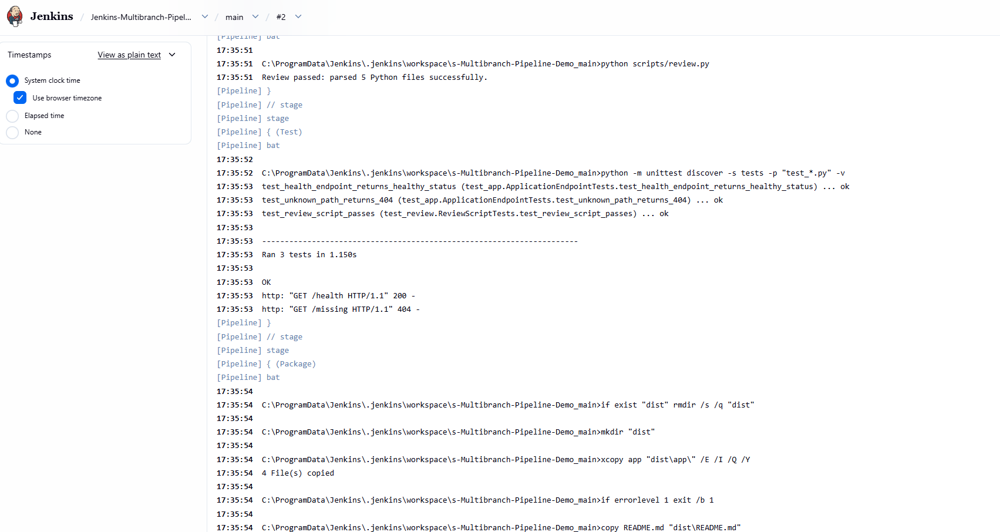
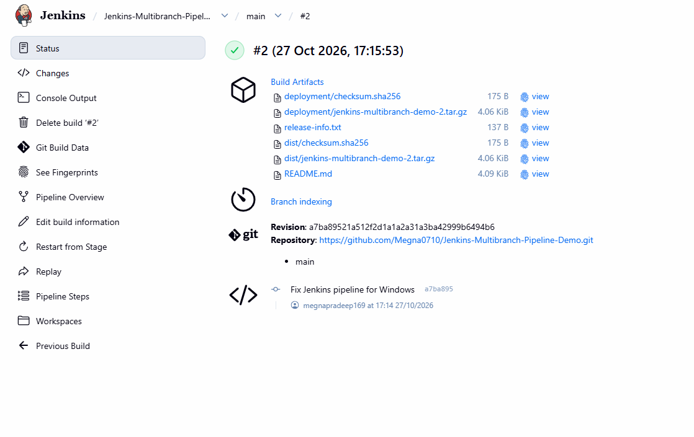

# Jenkins Multibranch Pipeline Demo

A Python application demonstrating a Jenkins Multibranch Pipeline with automated source checkout, compilation, code review, unit testing, packaging, and release artifact archiving.

The pipeline integrates Jenkins with GitHub and runs on a Windows environment using Windows-compatible batch commands.

## Pipeline Overview



The pipeline contains six stages:

| Stage | Description |
|---|---|
| Checkout | Retrieves the source code from the configured GitHub branch. |
| Compile | Checks the Python version and compiles the application and test files. |
| Review | Runs a Python review script to validate the source files. |
| Test | Executes automated unit tests using Python's `unittest` framework. |
| Package | Creates a compressed release archive and generates a SHA-256 checksum. |
| Deploy | Archives the release package, checksum, and release metadata in Jenkins. |

The Deploy stage publishes build artifacts within Jenkins; it does not deploy the application to an external server.

## Successful Build



The successful pipeline run demonstrates that Jenkins can retrieve the source code, execute the required checks, package the application, and archive the resulting artifacts.



## Automated Test Results



The pipeline runs automated tests covering:

- Health endpoint response.
- Handling of unknown paths.
- Review script validation.

All three unit tests passed in the successful build.

## Build Artifacts



The pipeline generates and archives the following files:

| Artifact | Purpose |
|---|---|
| `dist/jenkins-multibranch-demo-<BUILD_NUMBER>.tar.gz` | Compressed application release package. |
| `dist/checksum.sha256` | SHA-256 checksum output for the release archive. |
| `deployment/jenkins-multibranch-demo-<BUILD_NUMBER>.tar.gz` | Copy of the release package for artifact publishing. |
| `deployment/checksum.sha256` | Checksum file accompanying the release package. |
| `deployment/release-info.txt` | Branch, build number, and commit metadata. |

Jenkins archives the files from both `dist/` and `deployment/` and records artifact fingerprints.

## Technologies Used

- Jenkins
- Jenkins Declarative Pipeline
- Git and GitHub
- Python 3.12
- Python `unittest`
- Windows batch scripting
- GNU tar
- SHA-256 checksum generation

## Project Structure

```text
jenkins-multibranch-demo/
├── app/
│   └── Python application files
├── tests/
│   ├── test_app.py
│   └── test_review.py
├── scripts/
│   └── review.py
├── docs/
│   └── image/
│       ├── jenkins-pipeline-overview.png
│       ├── jenkins-build-success.png
│       ├── jenkins-test-results.png
│       ├── jenkins-console-success.png
│       └── jenkins-build-artifacts.png
├── Jenkinsfile
├── README.md
└── .gitignore
```

## Prerequisites

- Windows 10 or Windows 11.
- Jenkins installed and running.
- Git for Windows.
- Python 3.12 or a compatible Python 3 version.
- GNU tar or another compatible `tar` executable.
- A GitHub repository containing the project.

## Jenkins Multibranch Pipeline Configuration

1. Create a Multibranch Pipeline job in Jenkins.
2. Add the GitHub repository as the branch source.
3. Configure branch discovery.
4. Set the Script Path to `Jenkinsfile`.
5. Save the configuration and scan the repository.
6. Run the pipeline for the `main` branch.
7. Inspect the stage results, console output, and archived artifacts.

For a public repository, Jenkins can retrieve the source code without repository credentials. Authenticated access may be required for private repositories.

## Jenkinsfile Configuration

The pipeline is defined in the `Jenkinsfile` at the root of the repository. It uses Jenkins Declarative Pipeline syntax and Windows `bat` steps to execute commands on the Windows Jenkins agent.

The configuration includes:

- **Checkout:** Checks out the source code for the current branch and records the Git commit.
- **Compile:** Checks the Python version and compiles application and test files.
- **Review:** Runs `scripts/review.py` to validate source files.
- **Test:** Executes automated tests using Python's `unittest` framework.
- **Package:** Creates a versioned `.tar.gz` release archive and generates its SHA-256 checksum.
- **Deploy:** Runs on the `main` or `master` branch and archives the release package, checksum, and release metadata.

The pipeline also enables timestamps, disables concurrent builds, retains the ten most recent builds, and reports the final build status.

The Deploy stage publishes artifacts within Jenkins; it does not deploy the application to an external server.

The complete pipeline implementation is available in the repository's [`Jenkinsfile`](Jenkinsfile).

## Troubleshooting: Linux Shell Commands on Windows

### Problem

The original Jenkinsfile used the `sh` pipeline step to execute Unix shell commands. Jenkins was running directly on Windows, where the `sh` step could not locate a shell executable.

The build failed with an error similar to:

```text
java.io.IOException: Cannot run program "sh":
CreateProcess error=2,
The system cannot find the file specified
```

### Root Cause

The pipeline was written using Unix shell commands, but the Jenkins execution environment was Windows. Git Bash was installed on the machine, but Jenkins did not automatically use it for the `sh` pipeline step.

### Resolution

The Jenkinsfile was updated to use the Windows `bat` pipeline step and Windows-compatible commands.

| Original Unix command | Windows-compatible approach |
|---|---|
| `sh` | `bat` |
| `rm -rf` | `if exist ... rmdir /s /q` |
| `mkdir -p` | `mkdir` with directory checks where needed |
| `cp -R` | `xcopy` or `copy` |
| `sha256sum` | `certutil -hashfile ... SHA256` |
| Unix shell variables | Windows batch environment variables such as `%BUILD_NUMBER%` |

The packaging and deployment-artifact commands were also adapted to Windows batch syntax.

### Verification

After updating the Jenkinsfile:

- Python compilation completed successfully.
- The review script parsed five Python files successfully.
- All three unit tests passed.
- The release archive and checksum were generated.
- Jenkins archived the build and release artifacts.
- The pipeline finished with `SUCCESS`.

This troubleshooting process demonstrates the importance of matching Jenkins pipeline commands to the operating system on which the agent executes.

## Key Outcomes

- Configured a Jenkins Multibranch Pipeline connected to GitHub.
- Automated Python compilation, source review, and unit testing.
- Adapted pipeline execution from Unix shell commands to Windows batch commands.
- Generated versioned release archives and SHA-256 checksum files.
- Archived build outputs and release metadata in Jenkins.
- Verified a successful end-to-end CI pipeline run.

